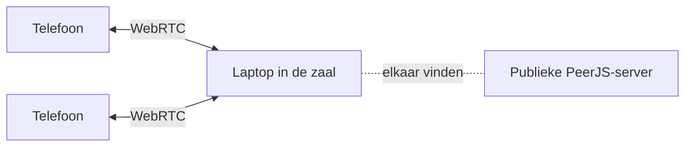

# Pickleball hussel systeem

[](https://github.com/lfb0801/pickleball-hussel-systeem/actions/workflows/tests.yml)

Een indelingssysteem voor pickleball-clubavonden. Het bepaalt per ronde wie met en tegen wie speelt op welke baan, ingedeeld op niveau, en rouleert rustbeurten eerlijk. Het houdt geen scores of ranglijst bij.

**Live:** <https://lfb0801.github.io/pickleball-hussel-systeem/>

## Hoe het werkt

Eén laptop of tablet in de zaal leidt de avond. Spelers sluiten aan met hun telefoon via een QR-code, melden zich aan met naam en niveau, zien hun baan en kunnen zelf pauzeren of vertrekken.



- **Geen server, geen database.** De app is een verzameling statische bestanden op GitHub Pages. Telefoons verbinden rechtstreeks met de laptop via [PeerJS](https://peerjs.com/); alleen het vinden van elkaar loopt via de gratis publieke PeerJS-server.
- **De laptop is de enige bron van waarheid.** Telefoons sturen verzoeken; de laptop past ze toe en stuurt de nieuwe toestand terug.
- **Telefoons zijn gemak, geen voorwaarde.** Alles wat een telefoon kan, kan de laptop ook, ook zonder internet.
- **Geen build-stap.** Gewone `<script>`-tags in plaats van ES-modules, zodat alles ook via `file://` werkt en dezelfde code onder Node te testen is.

## Projectstructuur

```
├── index.html               De laptop-app (organisator)
├── speler.html              De telefoon-app (via de QR-code)
├── assets/
│   ├── css/                 thema.css (huisstijl), stijl.css, speler.css
│   ├── js/
│   │   ├── kern/            Logica zonder schermen: algoritme, presets, sessie, opslag, verbinding, teksten
│   │   ├── laptop/          App-opstart en de schermen van de laptop
│   │   └── telefoon/        De telefoon-app
│   └── vendor/              PeerJS 1.5.4 en qrcode-generator 1.4.4, op een vaste versie
├── tests/
│   ├── tests.js             De testgevallen
│   ├── index.html           Testrunner in de browser
│   └── node.js              Dezelfde tests onder Node
└── scripts/
    └── stempel-versie.js    Zet een ?v=-versie achter elk eigen script en stijlblad
```

`assets/js/kern/hussel.js` (het algoritme) en `assets/js/kern/sessie.js` (verzoeken van telefoons verwerken) zijn pure functies zonder DOM of netwerk. Daardoor is elke indeling reproduceerbaar uit zijn invoer en zonder browser te testen.

## Lokaal draaien

Er is niets te installeren. Open `index.html` direct in de browser, of start een lokale server:

```bash
npm start
```

en ga naar <http://127.0.0.1:8080/>. Voor telefoons in hetzelfde netwerk is een server nodig die op het netwerkadres luistert.

## Tests

```bash
npm test
```

Een deel van de tests draaien met een filter op de naam: `node tests/node.js sessie`. In de browser staan dezelfde tests op `tests/index.html`.

## Uitgeven

De app draait op GitHub Pages vanaf de branch `master`. Pages laat browsers bestanden tien minuten bewaren; stempel daarom vóór elke commit die je pusht een nieuwe versie op alle eigen bestanden, zodat een browser nooit oude en nieuwe scripts door elkaar gebruikt:

```bash
npm run stempel
```
