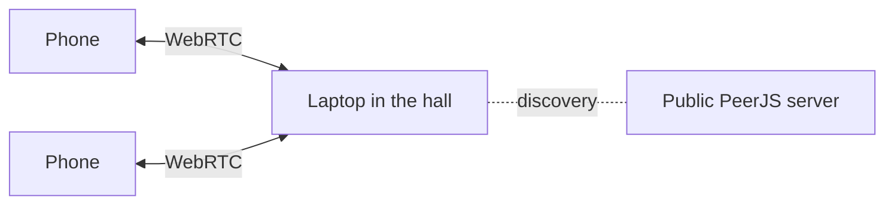

# Pickleball hussel

[](https://github.com/lfb0801/pickleball-hussel-systeem/actions/workflows/tests.yml)

A court scheduler for pickleball club evenings. Each round it decides who plays with and against whom on which court, grouped by level, and rotates rest turns fairly. It keeps no scores or rankings.

The app is available in Dutch (default) and English; the language can be switched at any time from the header, on the laptop and on each phone separately.

**Live:** <https://lfb0801.github.io/pickleball-hussel-systeem/>

## How it works

One laptop or tablet in the hall runs the evening. Players join with their phone by scanning a QR code, sign in with their name and level, see their court, and can pause or leave on their own.



- **No server, no database.** The app is a set of static files on GitHub Pages. Phones connect directly to the laptop via [PeerJS](https://peerjs.com/); only finding each other goes through the free public PeerJS server.
- **The laptop is the single source of truth.** Phones send requests; the laptop applies them and sends the new state back.
- **Phones are a convenience, not a requirement.** Everything a phone can do, the laptop can do too, even without internet.
- **Checking in works without internet.** Each phone can make a check-in pass: a QR code with its phone id, name and level. The laptop camera reads it and checks the player in, signing up someone new on the spot. The pass doesn't depend on the session, so it (or a screenshot of it) works every week. A phone that gets a connection later is already linked to its player.
- **Opened once, works offline.** A service worker (`sw.js`) keeps a copy of both pages, so they open in the hall without internet once they've been opened before. iPhones clear that copy after about a week without a visit, which is why the pass suggests a screenshot.
- **No build step.** Plain `<script>` tags instead of ES modules, so everything also works from `file://` and the same code can be tested under Node.

## Project structure

```
├── index.html                 The phone app (base URL, via the QR code)
├── host/index.html            The laptop app (organiser), at /host/
├── player.html, speler.html   Redirects for old links to the phone app
├── sw.js                      Service worker: offline copy of both pages
├── assets/
│   ├── css/                   theme.css (club branding), style.css, player.css
│   ├── js/
│   │   ├── core/              Logic without screens: pairing algorithm, presets, session rules,
│   │   │   │                  check-in pass, storage + migration, network, offline, i18n
│   │   │   └── locales/       nl.js (default) and en.js: every visible text
│   │   ├── laptop/            App start-up, the laptop screens and the pass scanner
│   │   └── phone/             The phone app
│   └── vendor/                PeerJS 1.5.4, qrcode-generator 1.4.4 and jsQR 1.4.0, pinned
├── tests/
│   ├── tests.js               Pairing, session and storage tests
│   ├── migrate-tests.js       Tests for upgrading data saved by older versions
│   ├── pass-tests.js          Tests for the check-in pass and checking in by scan
│   ├── index.html             Test runner in the browser
│   └── node.js                The same tests under Node
└── scripts/
    └── stamp-version.js       Appends a ?v= version to every local script and stylesheet
```

`assets/js/core/pairing.js` (the algorithm) and `assets/js/core/session.js` (applying requests from phones) are pure functions without DOM or network access. That makes every schedule reproducible from its input and testable without a browser.

## Languages

All visible text lives in `assets/js/core/locales/`. Static text in the HTML refers to it with `data-t="key"` (and `data-t-placeholder`, `data-t-title`, `data-t-aria-label`); text with values filled in is a function. To add a language, add a locale file with the same keys, load it in both HTML pages and add its code to `I18n.LANGUAGES` in `assets/js/core/i18n.js`. Keys missing from a locale fall back to Dutch.

## Running locally

Nothing to install. Open `host/index.html` directly in a browser (without the offline copy; the camera may not work from a local file), or start a local server:

```bash
npm start
```

and go to <http://127.0.0.1:8080/>. Phones on the same network need a server that listens on the network address. On localhost the service worker fetches from the network first, so changes show up straight away.

## Tests

```bash
npm test
```

Run a subset by filtering on the test name: `node tests/node.js session`. The same tests run in the browser at `tests/index.html`.

## Releasing

The app runs on GitHub Pages from the `master` branch. Pages lets browsers cache files for ten minutes, so before every commit you push, stamp a new version on all local files so a browser never mixes old and new scripts:

```bash
npm run stamp
```

This also bumps the version in `sw.js`. Browsers then fetch the new release for their offline copy in the background and use it from the next time the page opens.
